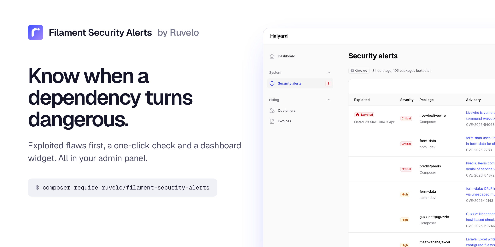
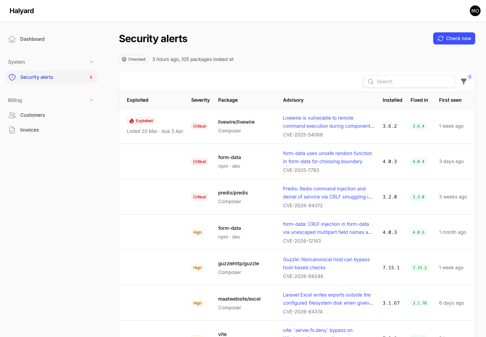
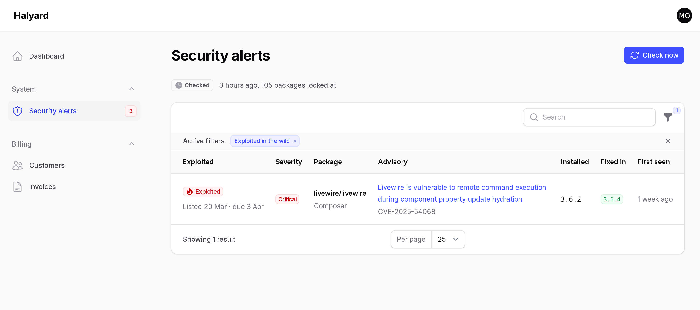
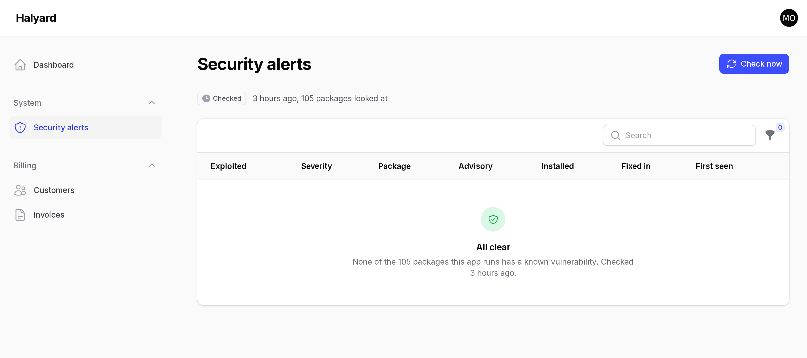
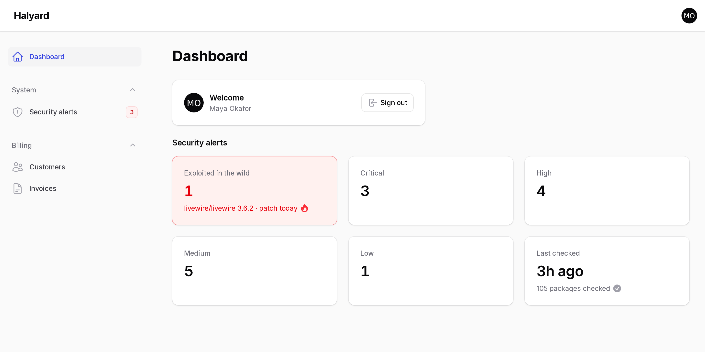
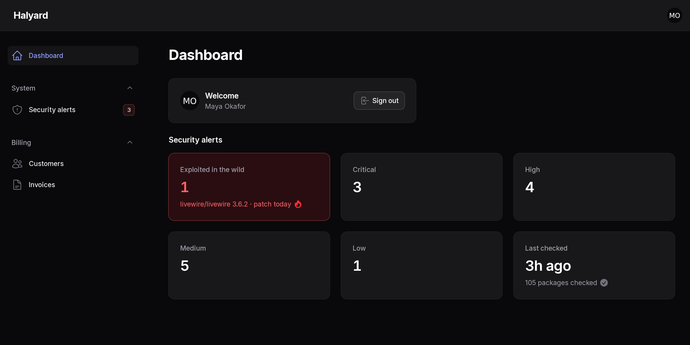
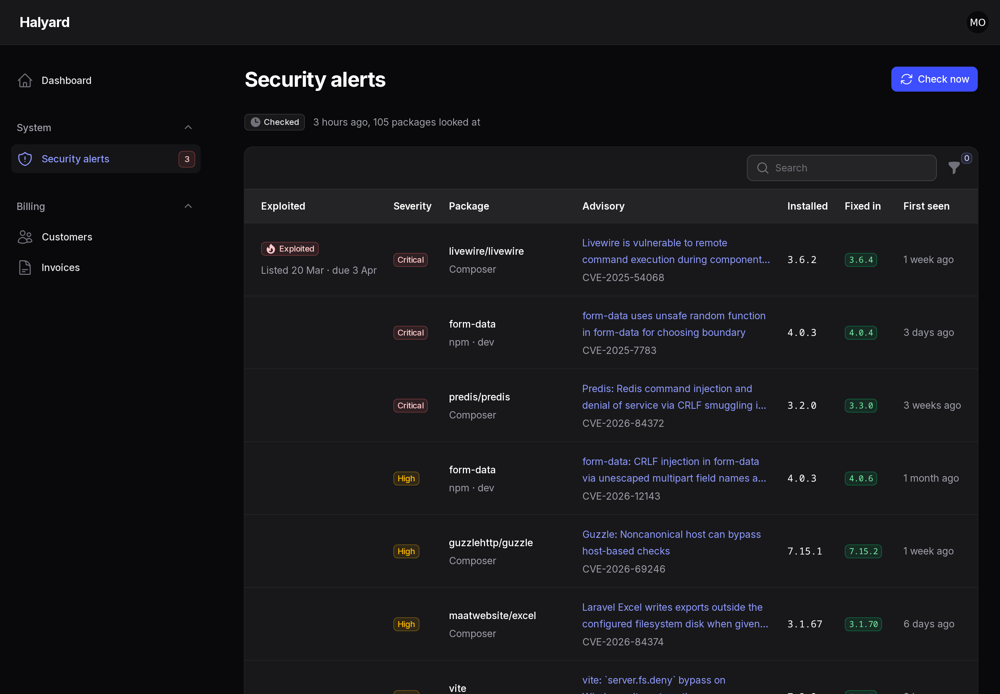
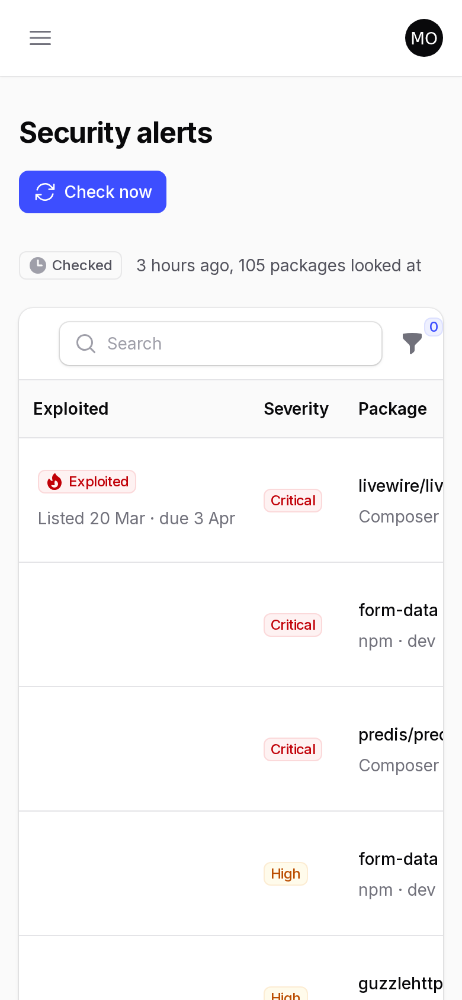

<p align="center">
  <a href="https://ruvelo.github.io/filament-security-alerts/"></a>
</p>

<p align="center">
  <a href="https://ruvelo.github.io/filament-security-alerts/"><strong>Live demo</strong></a> &nbsp;&nbsp;&nbsp;
  <a href="#configuration"><strong>Configuration</strong></a> &nbsp;&nbsp;&nbsp;
  <a href="#for-developers"><strong>Developer guide</strong></a> &nbsp;&nbsp;&nbsp;
  <a href="CHANGELOG.md"><strong>Changelog</strong></a>
</p>

<p align="center">
  <a href="https://github.com/Ruvelo/filament-security-alerts/actions/workflows/tests.yml"></a>
  
  
  
  
  <a href="LICENSE"></a>
</p>

# Filament Security Alerts

**Your [Laravel Security Alerts](https://github.com/Ruvelo/laravel-security-alerts), inside your Filament admin panel.** See which installed packages have known vulnerabilities, with the ones attackers are already exploiting at the top. Check again with one click, and keep an eye on it from the dashboard and the navigation.

```
composer require ruvelo/filament-security-alerts
php artisan migrate
```

Then add `SecurityAlertsPlugin::make()` to your panel (see [Install](#install)). Filament panels need a server, so the [live demo](https://ruvelo.github.io/filament-security-alerts/) is a gallery of screenshots; [the package's own demo](https://ruvelo.github.io/laravel-security-alerts/) is the real thing, rendered statically.

## A quick tour



**Exploited first.** Every open finding, with the flaw attackers are using at the top: the day CISA listed it and the day it must be patched by, the severity, the installed version and the one that fixes it. Titles open the advisory.



**Filter to what matters.** Severity, ecosystem (Composer or npm) and "exploited in the wild". Search covers package names, titles, CVEs and advisory IDs.



**And when it's fixed, it says so.** A check that finds nothing shows an "All clear", and the navigation badge goes away.

<table>
  <tr>
    <td width="50%"></td>
    <td width="50%"></td>
  </tr>
  <tr>
    <td><strong>On the dashboard</strong>: counts by severity, <strong>red</strong> when anything is exploited, and when the last check ran.</td>
    <td><strong>Filament's own look</strong>, in light and dark, in your panel's colours.</td>
  </tr>
  <tr>
    <td></td>
    <td></td>
  </tr>
  <tr>
    <td>The page in dark mode.</td>
    <td>And on a phone.</td>
  </tr>
</table>

## Features

- **A Security alerts page**: the package's open findings in a Filament table, exploited first, then by severity. Each row has the severity, a KEV badge with CISA's dates, the ecosystem, installed and fixed-in versions, when it was first seen, and a link to the advisory.
- **Filters and search**: severity, Composer or npm, exploited in the wild; search over package, title, CVE and advisory ID.
- **Check now**: runs the package's check with fresh feeds and says what it found: new, fixed, exploited, or "All clear". It never emails anyone unless you ask it to.
- **A dashboard widget**: exploited, critical, high, medium and low counts, red when anything is exploited, plus when the last check ran, with a warning if none ran in 48 hours (usually a stopped scheduler). Each count links to the filtered page.
- **A navigation badge** with the number of exploited and critical alerts, red when any is exploited, amber otherwise.
- **Access you control**: a `view-security-alerts` gate, or `canAccess()` with any closure. Running a check has its own switch.
- **Nothing to migrate or maintain**: no tables, no models and no feeds of its own. It reads the package's `security_alerts` table and cache and never calls a feed except when someone clicks Check now.
- **Filament 4 and 5**, light and dark, nothing global added to your panel.

Watching many sites? [Valtry](https://valtry.co.uk/?utm_source=ruvelo&utm_medium=github&utm_campaign=filament-security-alerts) scans them from the outside.

## Requirements

- PHP 8.3+
- Laravel 12 or 13, with the [scheduler](https://laravel.com/docs/scheduling#running-the-scheduler) running, so the daily check happens
- Filament 4 or 5
- [`ruvelo/laravel-security-alerts`](https://github.com/Ruvelo/laravel-security-alerts) ^1.0 (installed with this plugin)

## Install

```
composer require ruvelo/filament-security-alerts
php artisan migrate
```

`php artisan migrate` creates the package's `security_alerts` table. Then register the plugin on your panel:

```php
use Ruvelo\FilamentSecurityAlerts\SecurityAlertsPlugin;

public function panel(Panel $panel): Panel
{
    return $panel
        // ...
        ->plugin(SecurityAlertsPlugin::make());
}
```

That's all: the page, the dashboard widget and the badge appear. The daily check and the alert emails are the package's job; see its [README](https://github.com/Ruvelo/laravel-security-alerts#readme) for the mail address and schedule. Until the first check has run, the page says so and "Check now" fills it.

## Who can see it

The page lists the names and versions of everything your app runs, so decide who gets it.

- **By default**, everyone who can use the panel, unless your app defines the `view-security-alerts` gate:

  ```php
  Gate::define('view-security-alerts', fn (User $user) => $user->is_admin);
  ```

- **Or per panel**, with a closure that gets the panel user as `$user` (or type-hint `Authenticatable`):

  ```php
  SecurityAlertsPlugin::make()->canAccess(fn ($user) => $user->can('viewAny', Server::class));
  ```

The same rules hide the page, the navigation item and badge, and the widget. Running a check follows the page unless you define a `check-security-alerts` gate or pass `canCheck()`.

## Configuration

Everything has a default. Pass what you want to change:

```php
SecurityAlertsPlugin::make()
    ->navigationGroup('System')
    ->navigationLabel('Vulnerabilities')
    ->canAccess(fn ($user) => $user->is_admin)
    ->staleAfterHours(24);
```

| Method | Default | |
|---|---|---|
| `navigationGroup()` | none | Navigation group: a string, an enum or a closure |
| `navigationLabel()` | `Security alerts` | Label in the navigation, and the page's title |
| `navigationIcon()` | `Heroicon::OutlinedShieldExclamation` | Any Filament icon |
| `navigationSort()` | none | Position in the navigation |
| `navigationBadge()` | `true` | The exploited + critical count beside the item |
| `slug()` | `security-alerts` | URL segment: `/admin/security-alerts` |
| `canAccess()` | the `view-security-alerts` gate, if defined; else everyone in the panel | `bool` or a closure given `$user` |
| `canCheck()` | the `check-security-alerts` gate, if defined; else whoever can see the page | Who gets the Check now button |
| `notifyOnCheck()` | `false` | Also send the alert email or Slack message for what a manual check finds |
| `staleAfterHours()` | `48` | How long without a check before the widget and page warn |
| `widget()` | `true` | The dashboard widget |

Read the configuration back with `SecurityAlertsPlugin::get()`, the instance registered on the current panel.

**Why doesn't Check now send mail?** The scheduled check sends one email for everything new, and anything not sent waits for the next one. A button shouldn't email your team by surprise, so a manual check only records what it finds. Turn on `notifyOnCheck()` if you want it to behave exactly like the scheduled one.

**Check now calls Packagist, OSV and CISA** and can take several seconds on a large app. It uses fresh answers, not the cache. Only package names and versions are sent, exactly as in the package.

### URLs

With the default panel path and slug:

| | |
|---|---|
| `/admin/security-alerts` | The page |
| `/admin/security-alerts?tableFilters[exploited][isActive]=1` | Only exploited flaws (the widget's links use these) |
| `/admin/security-alerts?tableFilters[severity][values][0]=critical` | Only critical ones |

## Customising the look

The plugin uses Filament's components and your panel's colours. The suggested primary is Ruvelo ultramarine; pass a palette with `#3D4EFF` at 600, since `Color::hex('#3D4EFF')` makes buttons lighter. The few rules Filament has no class for (the red exploited stat, the green "All clear", the status line) are in `resources/views/styles.blade.php`; publish the views to change them:

```
php artisan vendor:publish --tag=filament-security-alerts-views
```

## For developers

### Classes you can extend or reuse

| Class | What it is |
|---|---|
| `SecurityAlertsPlugin` | The plugin and its options |
| `Pages\SecurityAlertsPage` | The page: table, filters, the Check now action |
| `Widgets\SecurityAlertsOverview` | The dashboard widget; add it to other pages with `->widgets([...])` |
| `Support\Summary` | Open alerts counted by severity and exploited, plus the last check and whether it's stale: what the badge, widget and status line read |

### Where the data comes from

This plugin has no models, tables or write path of its own. It reads `SecurityAlerts::open()` and `SecurityAlerts::lastCheck()` from [the package](https://github.com/Ruvelo/laravel-security-alerts#for-developers), and its one write is `SecurityAlerts::check()`, behind the Check now button. Don't write to the package's table yourself: that would break "send each alert once".

`lastCheck()` is remembered in the cache, so a `cache:clear` makes the page say "Not checked yet" until the next check. The open alerts themselves are in the database and survive it.

### In your tests

Create alerts with the package's factory and test the page as a Livewire component:

```php
use Livewire\Livewire;
use Ruvelo\FilamentSecurityAlerts\Pages\SecurityAlertsPage;
use Ruvelo\SecurityAlerts\Models\SecurityAlert;

$exploited = SecurityAlert::factory()->exploited()->forPackage('livewire/livewire', '3.6.2')->create();

Livewire::actingAs($admin)
    ->test(SecurityAlertsPage::class)
    ->assertCanSeeTableRecords([$exploited])
    ->filterTable('exploited')
    ->assertCanSeeTableRecords([$exploited]);
```

To test a check, `Http::preventStrayRequests()` and fake the feeds as the package's README describes, then `->callAction('check')->assertNotified()`.

### Laravel Boost

If your app uses [Laravel Boost](https://laravel.com/docs/boost), `php artisan boost:install` picks up this plugin's guidelines, so your coding agent registers it correctly and leaves the package's table alone.

## Contributing

Pull requests are welcome. Clone, `composer install`, then `composer check` runs code style (Pint), static analysis (PHPStan level 8) and the tests, exactly as CI does. The tests never touch the network: feeds are answered from recorded responses in `tests/fixtures`. See [CONTRIBUTING.md](CONTRIBUTING.md) and the [changelog](CHANGELOG.md).

The screenshots are taken from a real Halyard panel: `demo/screenshots.sh` regenerates `art/`.

## Credits

Built by [François Bultez](https://github.com/francoisbultez) at [Valtry](https://valtry.co.uk/?utm_source=ruvelo&utm_medium=github&utm_campaign=filament-security-alerts), the website security scanner, and everyone who [contributes](https://github.com/Ruvelo/filament-security-alerts/graphs/contributors).

## License

MIT. See [LICENSE](LICENSE).
